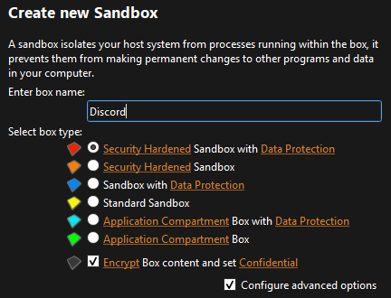
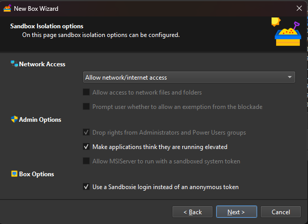
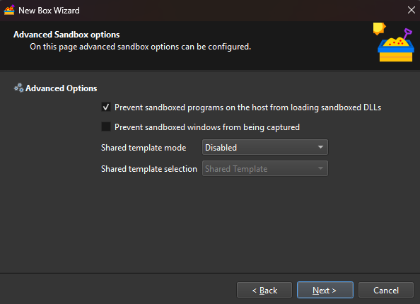
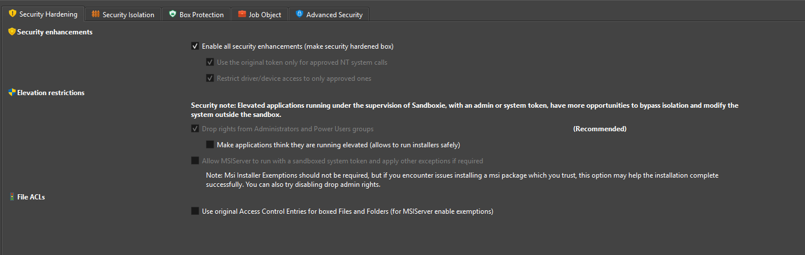
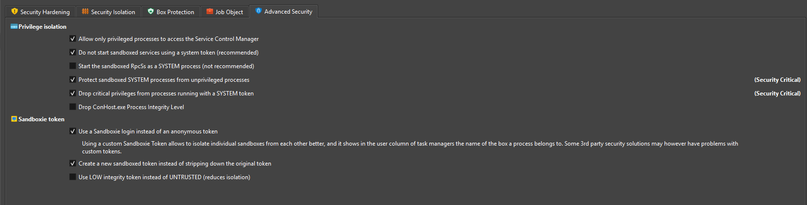
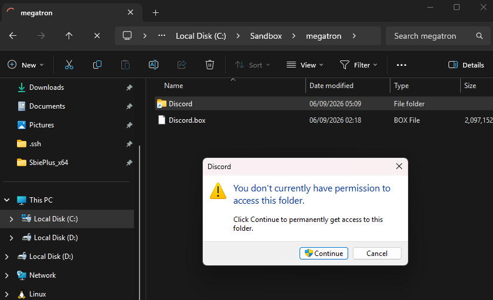
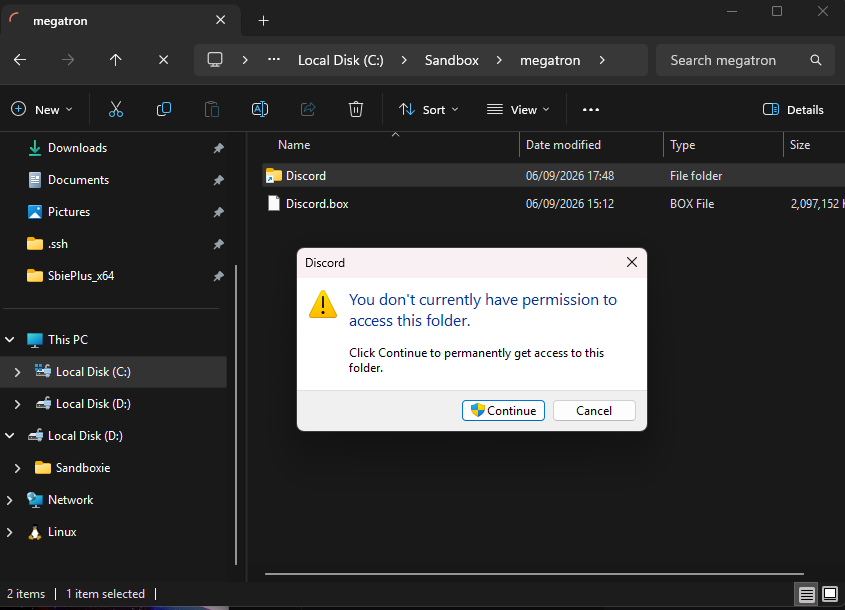

# Encrypted Sandboxie-Plus Discord Setup

> **Prerequisite:** This guide assumes a one-year Sandboxie-Plus Personal-Advanced
> subscription. The license can be reused on unlimited devices and continues to
> work after expiry — only *updates* require renewal.

---

## 1. Create the encrypted box

Create a new **secure, encrypted** box. During creation:

- Enable **"Mount Box Image"** with **"Protect Box Root From Access By Unsandboxed Processes"**.
  This protects the sandboxed filesystem from any process outside the box.
- Enable **"Lock the box when all processes stop"** so the encrypted image
  auto-unmounts once the last sandboxed program exits.

You can verify root protection is active at `C:\Sandbox\YOUR_USER` while the
sandbox is running (see [Verifying isolation](#5-verifying-isolation) below).















---

## 2. Compatibility settings (required on Windows 11)

In Sandboxie-Plus compatibility settings (**App Templates**), enable:

- **"Chromium Fix for Windows 11"**

Without this, Discord (and other Chromium-based apps) will fail to start on
Windows 11.

Disable "Make applications think they are running elevated" (the FakeAdminRights setting). Dorion's WebView2 rendering engine performs its own privilege checks at startup, and Sandboxie's fake elevation status conflicts with this, causing the app to launch with no visible window (silent WebView2 initialization failure, often paired with an SBIE2189 message or webview IPC error in the logs).

---

## 3. Install Discord inside the box

Make sure the box is mounted WITHOUT root protection for the installation. If root protection is on, the box's file system cannot be viewed in Windows Explorer.

Open a console **inside the encrypted sandbox**:
right-click the box → **Run → Standard Applications → Command Console (Admin)**.

Then run one of the following.

**Discord**

The manual install lays down Discord's files by hand rather than through the official installer. This produces an install that Discord's updater does not consider fully "finalized." Discord uses a native (Rust) updater — `updater.node`, loaded by the app on every launch — which validates its install plan against Discord's servers each time Discord starts.

When the installed version is the current published version, the updater tries tovalidate/finalize the *running* version. It finds `Discord.exe` already running from the target directory and treats this as fatal, throwing `InconsistentInstallerState: Attempt to install host that is currently running`. The window opens for a second, then closes.

Installing a version that is *behind* the server (here 1.0.9255) sidesteps the crash, because it routes the updater down the ordinary update path instead of the fatal finalize-the-running-version path.

Because the installed version is behind the server, Discord's updater does exactly what it's designed to do: on launch it detects a newer version, downloads it in the background, and applies it. So the manual install is only a *bootstrap* — a known-good starting point that launches cleanly — and Discord brings itself up to the current version automatically from there. You end up running the latest Discord without ever hitting the installer (which fails in the Privacy Enhanced box) and without hitting the updater crash.

```cmd#
"D:\Sandboxie\discord-sandbox\scripts\shared\install-discord.bat"
```

IMPORTANT: Before running this script, ensure that you have the installation path (NOT the session cookie store path in 'Roaming/' mapped as a Sandboxie folder outside the encrypted box, for the icon to show up properly):


**Dorion (lightweight Discord client):**

```cmd
curl -L -o "%USERPROFILE%\Downloads\Dorion-setup.exe" "https://github.com/SpikeHD/Dorion/releases/download/v6.13.0/Dorion_6.13.0_x64-setup.exe"
"%USERPROFILE%\Downloads\Dorion-setup.exe"
```

Then right click the box and create a shortcut for the installed Dorion on your desktop:


Map the shortcut to use your chosen icon. Note that when the box is unmounted or protected, icons
inside the box won't be available to Windows externally, and likewise to icons external; unless mapped to a shared folder.

---

## 4. Resource access

> **This is how you get files in and out of the encrypted box.**

The box's file system is sealed: with root protection on, the sandboxed
**Explorer closes immediately** and there is no in-box file browser by default,
so you cannot drag files in through a sandboxed window. To move files between
the host and the box, **one host folder is deliberately mapped through** — your
**Downloads** folder:

```
C:\Users\megatron\Downloads
```

Add this path under **Resource Access → File Access → Direct Access**
(the "Open for All Programs" option). Once set:

`Downloads` is the single, intentional opening in an otherwise sealed box — treat
it as the airlock. Anything outside it stays isolated. Keep this path as narrow
as you're comfortable with; widening it widens the host↔box surface.

#### [Toggle] Paste/attach files from anywhere except AppData

Privacy mode (`UsePrivacyMode=y`) hides every drive from the box, so a file
copied in Explorer from, say, `D:\Projects\` arrives in Discord as a path the box
cannot open and the paste silently fails. The rules live in a local template so
they can only be switched on and off **together**:

```ini
[Template_Local_ReadHostFiles]
Tmpl.Title=Read-only host files, AppData kept box-private
Tmpl.Class=Local
ReadFilePath=C:\*
ReadFilePath=D:\*
WriteFilePath=%USERPROFILE%\AppData\*
WriteFilePath=%USERPROFILE%\.*

[Discord]
Template=Local_ReadHostFiles
```

- `ReadFilePath` grants **read-only** access to the host drives — nothing in the
  box can write back to them.
- `WriteFilePath=%USERPROFILE%\AppData\*` is more specific, so it wins (rule
  specificity is always on in privacy mode) and keeps all of `AppData`
  box-private: Discord's profile and session token (`Roaming\discord`), the
  other folders Discord writes to (`Roaming\Microsoft`, `Roaming\NVIDIA`,
  `Local\…`), and the host's own `AppData` — browser cookies and other apps'
  tokens — which the box cannot see. The same goes for dot-folders such as
  `.ssh` and `.aws`.
- `WriteFilePath` is misleadingly named: it does **not** write to the host. It
  hides the host copy and confines writes to the box's own copy inside the
  encrypted image — the same rule that keeps `%LocalAppData%\Discord\` private.

**Never use `ReadFilePath=C:\*` without the `AppData` line.** The box would then
see your *host* `AppData` read-only, and Discord would fail to start with
`EPERM: operation not permitted, mkdir '…\AppData\Roaming\discord\…'` because its
own profile is hidden behind it — the template exists to make that split
impossible.

Folders exposed this way are read-only from inside the box, so save files to
`Downloads` (the airlock). Comment out `Template=Local_ReadHostFiles` to restore
full privacy isolation.


#### [Optional] Browse inside the box at runtime even when it's locked

explorer.exe is the Windows shell itself, not just a file browser — it needs broad window-station, IPC, and COM access to function, which is exactly what a hardened/privacy-mode box restricts by default. Running it inside such a box typically crashes it immediately. Explorer++ works because it's a standalone app that browses files without needing shell-level privileges. It can be installed and opened using the following command:

```cmd
curl -L -o "%USERPROFILE%\Downloads\explorerpp.zip" "https://github.com/derceg/explorerplusplus/releases/download/version-1.4.0/explorerpp_x64.zip"
mkdir "%USERPROFILE%\Downloads\Explorer++"
tar -xf "%USERPROFILE%\Downloads\explorerpp.zip" -C "%USERPROFILE%\Downloads\Explorer++"
"%USERPROFILE%\Downloads\Explorer++\Explorer++.exe"
```

#### [Toggle] Voice, hearing audio, camera and screen share

`UseSecurityMode=y` is shorthand for three settings, and the driver ORs it with
`RestrictDevices` (`restrict_devices = use_security_mode || RestrictDevices`), so
adding `RestrictDevices=n` next to it does nothing. To control device access
separately, `UseSecurityMode` is replaced by its parts:

```ini
UseRuleSpecificity=y
SysCallLockDown=y
DropAdminRights=y
#RestrictDevices=y
OpenDevCMApi=y
Template=LessConfidentialBox
SandboxieLogon=n
AnonymousLogon=n
#OriginalToken=y
#NotifyBoxProtected=y
```

- `SysCallLockDown` + `DropAdminRights` keep the hardened token and syscall
  filtering. ALPC/RPC connects are already on its approved list, so the audio
  service (`\RPC Control\AudioSrv`, `AudioClientRpc`) is reachable.
- `RestrictDevices=y` closes `\Device\*` except a short allow-list
  (`[TemplateSModPaths]` in `Templates.ini`), which blocks camera, capture and
  media endpoints. It is **commented out** so media works; uncomment to restore
  it.
- `OpenDevCMApi=y` lets the box enumerate host devices (microphones, cameras)
  through the Configuration Manager API.
- `LessConfidentialBox` exempts `audiodg.exe` from `ConfidentialBox`, so the
  Windows audio engine can attach to Discord's audio streams. That is enough
  for **playback**.
- **Microphone: currently broken in every Sandboxie box** on recent Windows 11
  builds (seen on 26300 with Sandboxie-Plus 1.18.8, still present in 1.19.0) —
  [sandboxie-plus/Sandboxie#5615](https://github.com/sandboxie-plus/Sandboxie/issues/5615),
  [#5672](https://github.com/sandboxie-plus/Sandboxie/issues/5672). The Windows
  audio service refuses capture streams from Sandboxie's restricted process
  token: `IAudioClient::Initialize` returns `E_INVALIDARG` (`0x80070057`) inside
  any box — including a default, unhardened one — while the identical call
  succeeds on the host. Playback is unaffected. `ConfidentialBox` exemptions,
  `OpenDevCMApi`, and lifting `RestrictDevices` were all tested and do not
  help.
- **The cause is the token's user identity.** Before restricting the token,
  Sandboxie replaces its user SID with a per-box Sandboxie account
  (`SandboxieLogon=y`) or Anonymous Logon, and Windows now refuses capture for
  that identity. `SandboxieLogon=n` + `AnonymousLogon=n` keep your real user SID
  as the token's identity — **still deny-only**, with every group deny-only,
  privileges stripped and Untrusted integrity — and capture works. Both lines
  are needed: `AnonymousLogon` only matters once `SandboxieLogon` is off.
  Tested one at a time with a WASAPI capture probe in the box:

  | Token settings | Capture |
  |---|---|
  | defaults | fails |
  | `NoUntrustedToken=y` | fails |
  | `KeepLogonSession=y` | fails |
  | `SandboxieLogon=n` + `AnonymousLogon=n` | **works** |
  | `OriginalToken=y` | works |

  What you give up: the box no longer has its own synthetic identity. File,
  registry and IPC redirection are unaffected, so Discord's token stays inside
  the encrypted box. Comment both lines out once a Sandboxie release fixes #5615.
- `OriginalToken=y` also fixes capture, but it hands boxed processes your full
  token (groups enabled, Medium integrity), and Sandboxie flags the box as an
  *INSECURE configuration*. Prefer the identity pair above. Processes inherit
  their parent's token under `OriginalToken`, so a Discord that restarts itself
  keeps the old token — empty the box before relaunching after toggling it.
- `NotifyBoxProtected=y` makes every refused host access show up as an SBIE1318
  message naming the host process — useful when diagnosing `ConfidentialBox`.

If something still fails, uncomment the `#…Trace=D` lines in `Sandboxie.ini`,
reload the config, reproduce the problem, then read the denied entries in
SandMan's **Trace Log** — each one is a resource to open with a narrow
`Normal…Path`/`Open…Path` rule. Re-comment the trace lines afterwards.

---

## 5. Launching Discord

Sandboxie-Plus can create shortcuts directly from its embedded viewer, or you
can launch the installed executable from a command line:

```cmd
"D:\Sandboxie\Installer\SbiePlus_x64\Start.exe" /box:YOUR_BOX_NAME cmd.exe /c start "" "%LocalAppData%\Discord\Update.exe" --processStart Discord.exe
```

```cmd
"D:\Sandboxie\Installer\SbiePlus_x64\Start.exe" /box:YOUR_BOX_NAME cmd.exe /c start "" 
"C:\Sandbox\megatron\Discord\user\current\AppData\Local\Dorion\Dorion.exe"
```

Replace `YOUR_BOX_NAME` with your box's name. If you installed Dorion instead,
point the launch at Dorion's executable inside the box.

Alternatively you can create a shortcut via the Sandboxie-Plus GUI:


---

## 6. Links open outside the sandbox — msedge.exe is a breakout process

> **`msedge.exe` is configured as a breakout process, so every link you click in
> Discord opens in your normal browser *outside* the sandbox.**

This is set under **Program Control → Breakout Programs** (INI:
`BreakoutProcess=msedge.exe`). When Discord hands a URL to the browser, Sandboxie
lets that browser process "break out" and run **unsandboxed on the host**, rather
than launching a browser trapped inside the box. Practically, that means:

- Clicking a link in Discord → opens in your host browser, normal session,
  normal profile.
- The sandbox stays dedicated to Discord itself; general web browsing happens on
  the host as usual.

Substitute your actual browser's process name if you don't use Edge (e.g.
`chrome.exe`, `firefox.exe`).

**Advanced variant:** if you'd rather the broken-out browser land in a *dedicated*
web-browsing box instead of the host, pair the breakout with a
BreakoutDocument / target-box directive so the broken-out program is captured
into that other box rather than escaping to the host.

---

## 7. Verifying isolation

With the box running, confirm the sandboxed filesystem is sealed from the host.
In normal Windows File Explorer, try to open:

```
C:\Sandbox\YOUR_USER\YOUR_SANDBOX\user\current\AppData\Roaming\discord
```

Opening `C:\Sandbox\YOUR_USER` — or any path beneath it — should produce an
**Access Denied** error from Windows.

## 8. Automatic unlock (TPM-sealed passphrase)

Rather than typing the box password each time, the passphrase is sealed to the
machine's TPM and gated behind Windows Hello, then handed to Sandboxie to mount
the box and open Discord. Two scripts handle this.

Run **`setup-sbiebox.ps1` once**, as the user who will launch the box. It creates
a non-exportable RSA key inside the TPM (the private key can never leave the
chip), prompts for the box passphrase a single time, encrypts it with that key,
and writes only the ciphertext to `%LOCALAPPDATA%\sbiebox.bin` — the plaintext is
never stored. Because the key is created with a ProtectKey UI policy, the TPM
will demand Windows Hello (PIN or biometric) on every future decrypt. Re-running
setup is blocked once the key exists; see the script header to reset.

**`unlock-sbiebox.ps1` runs on every launch** and is what the shortcut actually
calls. It first checks whether the box is already mounted; if it is, it skips
straight to launching another client instance. If not, it opens the TPM key —
triggering the Windows Hello prompt — decrypts the blob to recover the
passphrase, mounts the encrypted box with root protection, scrubs the passphrase
from memory, and launches Dorion inside the box. One shortcut therefore both
opens the box the first time and relaunches afterward.

The `.ps1` is invoked through a small VBS wrapper (`launch-discord.vbs`) so no
console window flashes; point your shortcut's target at that `.vbs`, give it
Discord's icon, and pin it anywhere. A single click releases the passphrase after
Windows Hello, mounts the box, and opens Dorion.

**Locking again on exit.** A box mounted through `Start.exe /mount_protected`
never auto-unmounts — `SbieDll_Mount` hard-codes `auto_unmount = FALSE`, so the
"Lock the box when all processes stop" option from step 1 does not apply to it.
The launch that mounted the box therefore keeps running hidden, polls
`Start.exe /listpids` every 5 s, and runs `Start.exe /box:Discord /unmount` once
the box has been empty for two polls in a row (`$UnmountWhenEmpty` in the
script's configuration block). Closing Discord's window only hides it to the
tray — use **Quit Discord** from the tray icon to empty and lock the box.

The box password is never typed routinely or stored in plaintext — it
exists only as TPM-sealed ciphertext, useless without this machine's TPM, and
unlockable only after Windows Hello confirms it's you. Combined with the
auto-unmount from step 1, the encrypted box is mounted on demand and torn down
when you're done. Note one boundary: mounting passes the passphrase on
`Start.exe`'s command line, where it's briefly visible to local process
inspection while the mount runs.

### Troubleshooting Icon Not Appearing on Windows 11

Make sure the installation directory (NOT the session/login token directory) is mapped OUTSIDE the box:

```ini
OpenFilePath=%LocalAppData%\Discord\
```

### Duplicate Taskbar Icons

The AUMID needs to be set on the shortcut to be identical to the one Sandboxie-Plus sets:

Make sure the sandboxed window is open before running the command in PowerShell:

```PowerShell
.\scripts\get-window-aumid.ps1 -ProcessName Discord
```


```PowerShell
.\scripts\set-shortcut-aumid.ps1 -Aumid 'Sandbox.Discord.com_squirrel_Discord_Discord' -ShortcutName 'Discord.lnk' -RestartExplorer
```

### Full Isolation

Change the mapping in `Sandboxie.ini` to the following for `%LocalAppData%\Discord\`:

```
WriteFilePath=%LocalAppData%\Discord\
```

This allows the taskbar to resolve the icon (write-only `%LocalAppData%\Discord\`) BUT edits/changes to the directory outside the sandboxed runtime process DO NOT CHANGE what the box is using internally.

This protects against **host-side client injection** — the one seam left open by the
`OpenFilePath` icon fix above.

With `OpenFilePath`, the sandboxed Discord reads its program files *directly from the
host*, so any process running on the host as your user — **no admin required** — can
write malicious JavaScript into Discord's core module:

```
%LocalAppData%\Discord\app-<version>\modules\discord_desktop_core-1\discord_desktop_core\index.js
```

Discord does not verify or sign these module files at load time, so on the next launch
the box would **read that host file and execute it in-process, with your live token in
memory**. This is exactly how a Discord token grabber persists and lifts a *valid,
current* token without ever touching the encrypted session store — that store lives in
`Roaming\` inside the box and is already invisible to the host (see
[Verifying isolation](#7-verifying-isolation)). The install directory was the only piece
still being read from the host, and therefore the only place an on-host grabber could
reach code that runs inside the box.

`WriteFilePath` closes it. A write-only path hides the host copy of
`%LocalAppData%\Discord\` **from sandboxed processes only** — the box sees just its own
in-box binaries and never reads host-side edits, so an injected `index.js` planted on the
host has no effect on what runs inside. Host processes still see the real directory, which
is why the **taskbar icon continues to resolve**: the shell (a host process) reads the
host files, while the sandboxed runtime is insulated from any change made to them. Because
the host copy is hidden from the box, Discord must be installed *inside* the box
(step [3](#3-install-discord-inside-the-box)) — which this setup already does.

See also: https://sandboxie-plus.com/sandboxie/writefilepath/

The only remaining route to that code is execution *inside* the box itself (e.g. an
untrusted Discord mod or plugin). Running **vanilla Discord and nothing else** in the box
keeps that path closed as well.

You can confirm the hiding works: with the box running, create a marker file such as
`HOSTONLY.txt` in the host `%LocalAppData%\Discord\` directory, then list that directory
from a **sandboxed** console — the marker should not appear. Delete it afterward. 

### Verifying Task Icon Persistence

Flush and reload the Windows icon cache:

```sh
taskkill /f /im explorer.exe
ie4uinit.exe -show
del /a /q "%LocalAppData%\IconCache.db"
del /a /q "%LocalAppData%\Microsoft\Windows\Explorer\iconcache*"
del /a /q "%LocalAppData%\Microsoft\Windows\Explorer\thumbcache*"
start explorer.exe
```

---

*Confirmed working on Windows 11 Pro as of 2026-02-09 with enhanced security features enabled.*


