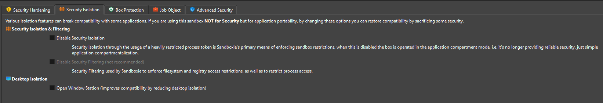
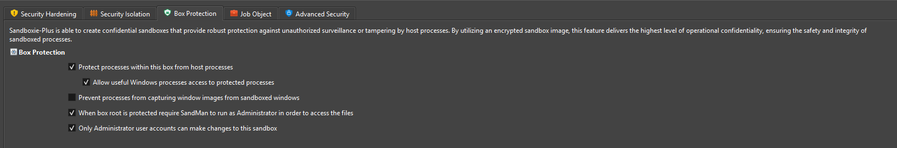
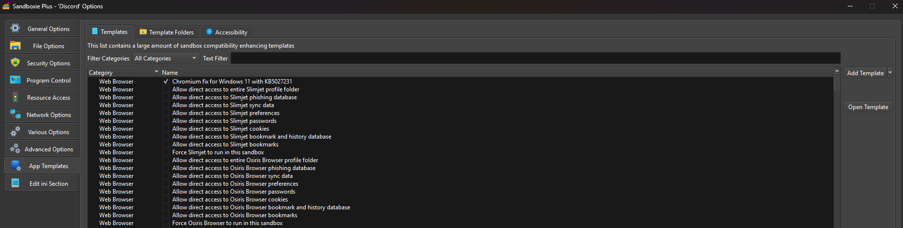
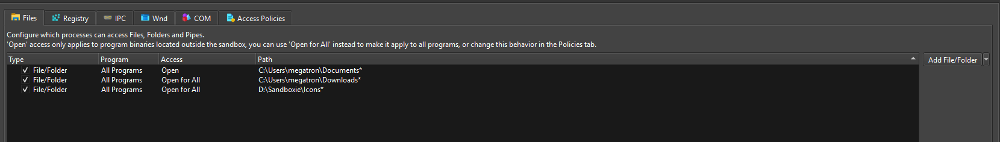
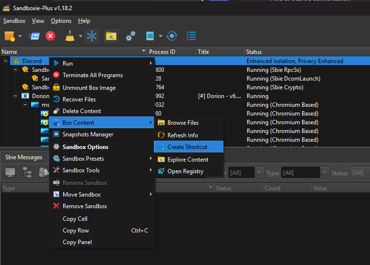
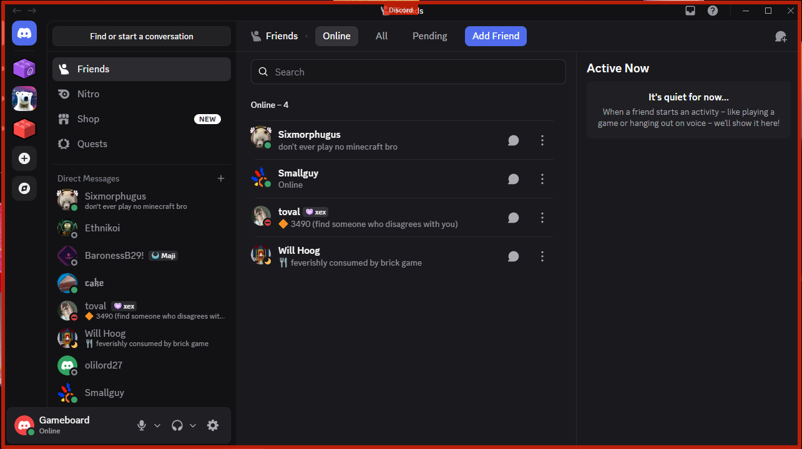
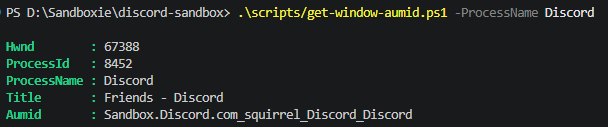

# Discord in an Encrypted Sandboxie-Plus Box

Run the Discord desktop app inside an **encrypted, locked-down sandbox** so that
your Discord login can't be stolen by malware running on your PC.

What you get:

- 🔒 **Your Discord login stays locked away.** Discord keeps its login token in
  `%AppData%\discord`. Here that folder lives only inside an encrypted container
  that other programs on your PC can't open — the classic "token grabber" has
  nothing to grab.
- 👆 **One click to start.** A desktop shortcut unlocks the container with
  Windows Hello (PIN or fingerprint), opens Discord, and locks the container
  again when you quit.
- 🎙️ **Everything still works.** Voice, video, screen share, and pasting files.
- 🌐 **Links open in your normal browser**, outside the sandbox.

> New to Sandboxie? A *sandbox* (or *box*) is a container that a program runs
> inside. The program thinks it is using your normal files and settings, but its
> changes land inside the box instead. See
> [What is Sandboxie?](https://sandboxie-plus.com/sandboxie/) for the basics.

---

## Contents

1. [Before you start](#before-you-start)
2. [Step 1 — Create the encrypted box](#step-1--create-the-encrypted-box)
3. [Step 2 — Apply this guide's box settings](#step-2--apply-this-guides-box-settings)
4. [Step 3 — Install Discord inside the box](#step-3--install-discord-inside-the-box)
5. [Step 4 — Set up the one-click shortcut](#step-4--set-up-the-one-click-shortcut)
6. [Using it day to day](#using-it-day-to-day)
7. [Optional settings](#optional-settings)
8. [Check that it's working](#check-that-its-working)
9. [Troubleshooting](#troubleshooting)
10. [Learn more](#learn-more)

---

## Before you start

You'll need:

- **Windows 11** with a **TPM** and **Windows Hello** (PIN or fingerprint) set up.
  Most PCs from the last few years have both.
- **[Sandboxie-Plus](https://sandboxie-plus.com/downloads/)** installed.
- A **[Sandboxie-Plus supporter certificate](https://sandboxie-plus.com/supporter-certificate/)**.
  Encrypted boxes and several protections below need one. A one-year
  Personal-Advanced certificate works on any number of your devices and keeps
  working after it expires — only *updates* need a renewal.
- **This repository** downloaded somewhere on your PC. The examples below use
  `D:\Sandboxie\discord-sandbox` — change that path to wherever you put it, and
  change `megatron` to your Windows user name.

---

## Step 1 — Create the encrypted box

In Sandboxie-Plus, create a new box from the **Sandbox** menu (or the first
toolbar button).

1. Name the box **`Discord`** and pick **Security Hardened Sandbox with Data
   Protection**. Tick **Encrypt Box content and set Confidential** and
   **Configure advanced options**.

   

2. When asked, set a **strong password** for the box image, and turn on:
   - **Mount Box Image** with **Protect Box Root From Access By Unsandboxed
     Processes** — programs outside the box can't read its files.
   - **Lock the box when all processes stop**.

3. Accept the remaining wizard pages as shown:

   

   

Docs: [Box encryption](https://sandboxie-plus.com/sandboxie/boxencryption/) ·
[Security Hardened mode](https://sandboxie-plus.com/security-mode/) ·
[Data Protection (Privacy) mode](https://sandboxie-plus.com/privacy-mode/) ·
[Confidential box](https://sandboxie-plus.com/sandboxie/confidentialbox/)

---

## Step 2 — Apply this guide's box settings

Rather than ticking dozens of boxes by hand, copy the ready-made settings from
this repository's [`Sandboxie.ini`](Sandboxie.ini).

1. Right-click the **Discord** box → **Sandbox Options** → **Edit ini Section**.
2. Replace the contents with everything under `[Discord]` in this repo's
   [`Sandboxie.ini`](Sandboxie.ini) (don't include the `[Discord]` line itself),
   fix the paths for your PC, and click **Apply**.
3. For the optional [paste-from-anywhere](#paste-files-from-anywhere-on-your-pc)
   feature, the `[Template_Local_ReadHostFiles]` section has to go in the main
   configuration file too: open Notepad **as administrator**, open
   `C:\Windows\Sandboxie.ini`, paste the section just above `[Discord]`, save,
   then in Sandboxie-Plus choose **Options → Reload configuration**. To skip
   the feature, delete the `Template=Local_ReadHostFiles` line instead.

Changes take effect the next time Discord starts.

<details>
<summary>What these settings do, in plain words</summary>

| Setting | What it does |
|---|---|
| Encryption + root protection | Discord's files, including your login, live in an encrypted file that only the box can open. ([docs](https://sandboxie-plus.com/sandboxie/usefileimage/)) |
| Data Protection | The box can't see your personal files unless you allow it. It also keeps Discord's program files and login private to the box, so nothing outside can read or tamper with them. ([docs](https://sandboxie-plus.com/privacy-mode/)) |
| Confidential box | Programs on your PC can't peek into Discord's memory. ([docs](https://sandboxie-plus.com/sandboxie/confidentialbox/)) |
| Hardening (`SysCallLockDown`, `DropAdminRights`) | Discord runs with very few rights. ([docs](https://sandboxie-plus.com/security-mode/)) |
| `OpenPipePath=…\Downloads\` | Your **Downloads** folder is shared with the box — the way to move files in and out. ([docs](https://sandboxie-plus.com/sandboxie/openpipepath/)) |
| `BreakoutProcess=msedge.exe` | Links open in Edge outside the box. Change it to `chrome.exe` or `firefox.exe` for your browser. ([docs](https://sandboxie-plus.com/sandboxie/breakoutprocess/)) |
| `ForceFolder` / `ForceProcess` | Discord always starts inside the box, even if you start it some other way. ([docs](https://sandboxie-plus.com/sandboxie/forcefolder/)) |
| Voice/camera lines | See [Voice, camera and screen share](#voice-camera-and-screen-share). |

The full reasoning is in [docs/TECHNICAL.md](docs/TECHNICAL.md).
</details>

For reference, this is how the same settings look in the Sandboxie-Plus window:








---

## Step 3 — Install Discord inside the box

Discord has to be installed **inside** the box so its files never touch your PC.

1. In Sandboxie-Plus, right-click the **Discord** box →
   **Run → Standard Applications → Command Console (Admin)**.
2. Run the install script from this repo:

   ```cmd
   "D:\Sandboxie\discord-sandbox\scripts\shared\install-discord.bat"
   ```

The script installs a slightly **older** Discord on purpose. Discord's official
installer doesn't work in this kind of box, and a hand-installed copy of the
*current* version crashes on start. An older copy starts cleanly and then
updates itself to the latest version in the background. (Details in
[docs/TECHNICAL.md](docs/TECHNICAL.md#why-the-install-script-uses-an-older-discord).)

> ⚠️ On some recent Windows 11 builds, console windows can't start inside any
> Sandboxie box — see [Troubleshooting](#a-console-window-wont-open-in-the-box-sbie1231).

<details>
<summary>Alternative: Dorion, a lightweight Discord client</summary>

```cmd
curl -L -o "%USERPROFILE%\Downloads\Dorion-setup.exe" "https://github.com/SpikeHD/Dorion/releases/download/v6.13.0/Dorion_6.13.0_x64-setup.exe"
"%USERPROFILE%\Downloads\Dorion-setup.exe"
```

Dorion needs **Make applications think they are running elevated** turned
**off** (`FakeAdminRights=n`), or its window never appears.
([docs](https://sandboxie-plus.com/sandboxie/fakeadminrights/))
</details>

---

## Step 4 — Set up the one-click shortcut

Instead of typing the box password every time, it's stored encrypted, and only
your PC's security chip (TPM) can decrypt it, each time after Windows Hello
confirms it's you.

1. **Once:** open PowerShell and run the setup script. Enter the box password
   when asked — it's encrypted with the TPM and never saved in plain text.

   ```powershell
   D:\Sandboxie\discord-sandbox\scripts\setup-sbiebox.ps1
   ```

2. Open [`scripts/unlock-sbiebox.ps1`](scripts/unlock-sbiebox.ps1) in a text
   editor and check the settings at the top — mainly `$StartExe` (where
   Sandboxie-Plus is installed) and `$BoxName`.

3. **Once, as administrator:** make the scripts and Sandboxie's files read-only
   for your normal account, so other programs can't tamper with what handles
   your password ([why](docs/TECHNICAL.md#why-the-scripts-must-be-read-only)).
   Do this after step 2. Later edits to `scripts\` need an administrator
   prompt.

   ```powershell
   D:\Sandboxie\discord-sandbox\scripts\protect-folders.ps1
   ```

4. Create a desktop shortcut whose target is
   `D:\Sandboxie\discord-sandbox\scripts\launch-discord.vbs`, give it Discord's
   icon, and pin it to the taskbar or Start.

Clicking the shortcut asks for Windows Hello, unlocks the box, and opens
Discord. If Discord is already running, it just brings up another window.

You can also start Discord from Sandboxie-Plus itself (right-click the box →
**Box Content → Create Shortcut**), but then you type the box password yourself:



---

## Using it day to day

- **Start Discord:** click your shortcut and approve Windows Hello.
- **Quit Discord:** right-click Discord's tray icon → **Quit Discord**. Closing
  the window only hides it in the tray. Once Discord has fully quit, the box
  locks itself within a few seconds.
- **Updates:** before Discord starts, the shortcut clears out old Discord
  versions, half-finished updates and caches inside the box, so updates don't
  fill it up. What it removed, and how each launch went, is in
  `scripts\shared\launch.log`.
- **Send a file:** paste or drag it into Discord as usual. With the
  [paste-from-anywhere](#paste-files-from-anywhere-on-your-pc) option on, this
  works for files almost anywhere on your PC.
- **Save a file from Discord:** save it to **Downloads** — the one folder shared
  in both directions.
- **Click a link:** it opens in your normal browser, outside the box.



---

## Optional settings

Each option is a line in the `[Discord]` section. Add a `#` at the start of a
line to turn it off, remove the `#` to turn it on, then restart Discord.

### Paste files from anywhere on your PC

```ini
Template=Local_ReadHostFiles
```

Lets Discord **read** (never change) files on your `C:` and `D:` drives, so you
can paste or attach them. Your `AppData` folder (browser logins, other apps'
data, and Discord's own login) and hidden dot-folders such as `.ssh` stay
invisible to the box.

- Folders shared this way are read-only inside the box — save files to
  Downloads instead.
- To add another drive, add a `ReadFilePath=E:\*` line to the
  `[Template_Local_ReadHostFiles]` section.
- **Don't** add `ReadFilePath=C:\*` straight into `[Discord]`. Without the
  template's `AppData` line, Discord can't start and your browser data becomes
  visible to the box.

Docs: [ReadFilePath](https://sandboxie-plus.com/sandboxie/readfilepath/) ·
[WriteFilePath](https://sandboxie-plus.com/sandboxie/writefilepath/) ·
[Rule specificity](https://sandboxie-plus.com/sandboxie/rulespecificity/)

### Voice, camera and screen share

These are on by default in this guide's settings:

```ini
#RestrictDevices=y
OpenDevCMApi=y
Template=LessConfidentialBox
SandboxieLogon=n
AnonymousLogon=n
```

| Line | Why it's needed | Docs |
|---|---|---|
| `#RestrictDevices=y` (off) | When on, it blocks the devices used for audio, camera and screen capture. | [RestrictDevices](https://sandboxie-plus.com/sandboxie/restrictdevices/) |
| `OpenDevCMApi=y` | Lets Discord see your microphones and cameras. | [OpenDevCMApi](https://sandboxie-plus.com/sandboxie/opendevcmapi/) |
| `Template=LessConfidentialBox` | Lets Windows' audio engine play Discord's sound. | [ConfidentialBox](https://sandboxie-plus.com/sandboxie/confidentialbox/) |
| `SandboxieLogon=n` + `AnonymousLogon=n` | **Microphone fix.** A recent Windows update stopped microphones working in every Sandboxie box ([issue #5615](https://github.com/sandboxie-plus/Sandboxie/issues/5615)). These two lines fix it while keeping Discord locked down. Remove them once Sandboxie releases a fix. | [SandboxieLogon](https://sandboxie-plus.com/sandboxie/sandboxielogon/) |

`OriginalToken=y` also fixes the microphone, but it removes much more
protection and Sandboxie marks the box as insecure — use the two lines above
instead. ([docs](https://sandboxie-plus.com/sandboxie/originaltoken/))

---

## Check that it's working

With Discord running, open File Explorer and go to `C:\Sandbox\YOUR_USER\`.
Opening the `Discord` folder should be refused:


Click **Cancel**. If you can browse inside the folder, root protection is off —
revisit [Step 1](#step-1--create-the-encrypted-box).

---

## Troubleshooting

#### Discord says "EPERM: operation not permitted, mkdir …\AppData\Roaming\discord"

The box is showing Discord your PC's `AppData` instead of its own. This happens
if `ReadFilePath=C:\*` is in the `[Discord]` section without the `AppData` rule.
Use `Template=Local_ReadHostFiles` instead — see
[Paste files from anywhere](#paste-files-from-anywhere-on-your-pc).

#### Others can't hear me

1. Make sure the [voice settings](#voice-camera-and-screen-share) are in your
   `[Discord]` section.
2. Fully quit Discord, then in Sandboxie-Plus right-click the box →
   **Terminate All Programs**, and start Discord again. Settings only apply to
   programs started afterwards.
3. Check **Windows Settings → Privacy & security → Microphone → Let desktop apps
   access your microphone** is on.

#### Discord's updater keeps saying "Update failed, retrying"

There are two causes:

- **`WriteFilePath=%LocalAppData%\Discord\` is in your `[Discord]` section.** An
  earlier version of this guide added it. Discord's updater then can't see the
  update it just downloaded, and fails every time. Remove the line (see
  [the technical notes](docs/TECHNICAL.md#dont-add-writefilepathlocalappdatadiscord)),
  then quit and restart Discord. The stuck update finishes by itself.
- **The box is full.** Each Discord update adds a new copy of Discord beside the
  old ones, and the box has a fixed size. The shortcut clears out old copies,
  but only when nothing is running in the box:
  1. Close the stuck updater: in Sandboxie-Plus, right-click the box →
     **Terminate All Programs**. Wait a few seconds for the box to lock.
  2. Click the shortcut again.
  3. If it still fails, open `scripts\shared\launch.log`. Each `WARN` line
     says what couldn't be removed and why. If nothing is left to remove, the
     box is too small: make a bigger one.

#### Clicking the shortcut does nothing the first time

Update to the latest `scripts\` from this repo. Older versions launched Discord
before the box had finished unlocking, or ran the cleanup as a separate
program, after which Sandboxie ended Discord's launch
([details](docs/TECHNICAL.md#starting-discord)). Then open
`scripts\shared\launch.log`: it shows each step of the last launch, with
timings, and a `WARN` line for whatever failed.

#### The box stays unlocked after I close Discord

Closing the window only hides Discord in the tray. Use **Quit Discord** from the
tray icon. If you started Discord from Sandboxie-Plus rather than the shortcut,
lock the box yourself: right-click it → **Unmount Box Image**.

#### A console window won't open in the box (SBIE1231)

On some recent Windows 11 Insider builds, Sandboxie-Plus 1.18.8 can't start
console programs (`cmd.exe`, PowerShell) in any box. The message log shows
`SBIE1231 Initialization failed for process` followed by
[`SBIE2314`](https://sandboxie-plus.com/sandboxie/sbie2314/). Discord itself is
unaffected. Check for a newer Sandboxie-Plus release.

#### Two Discord icons on the taskbar


Give the shortcut the same identity Sandboxie gives the Discord window. With
Discord open, run in PowerShell from this repo's folder:

```powershell
.\scripts\get-window-aumid.ps1 -ProcessName Discord
```



Then copy the `Aumid` value into:

```powershell
.\scripts\set-shortcut-aumid.ps1 -Aumid 'Sandbox.Discord.com_squirrel_Discord_Discord' -ShortcutName 'Discord.lnk' -RestartExplorer
```

#### The shortcut or taskbar icon is blank

Refresh Windows' icon cache from a Command Prompt:

```cmd
taskkill /f /im explorer.exe
ie4uinit.exe -show
del /a /q "%LocalAppData%\IconCache.db"
del /a /q "%LocalAppData%\Microsoft\Windows\Explorer\iconcache*"
start explorer.exe
```

#### Still stuck?

- Look in Sandboxie-Plus's **Messages** panel at the bottom — each `SBIExxxx`
  code links to an explanation.
- Turn on tracing to see exactly what the box blocks:
  [File/IPC trace](https://sandboxie-plus.com/sandboxie/filetrace/).
- Search the [Sandboxie-Plus issues](https://github.com/sandboxie-plus/Sandboxie/issues)
  and [known conflicts](https://sandboxie-plus.com/sandboxie/knownconflicts/).

---

## Learn more

- [docs/TECHNICAL.md](docs/TECHNICAL.md) — how and why each part of this setup
  works, with the test results behind it.
- Sandboxie-Plus docs: [all settings (Sandboxie.ini)](https://sandboxie-plus.com/sandboxie/sandboxieini/) ·
  [Resource access rules](https://sandboxie-plus.com/sandboxie/resourceaccess/) ·
  [Start.exe command line](https://sandboxie-plus.com/sandboxie/startcommandline/)
- Source code and issue tracker:
  [github.com/sandboxie-plus/Sandboxie](https://github.com/sandboxie-plus/Sandboxie)

---

*Last confirmed working on Windows 11 Pro build 26300 with Sandboxie-Plus 1.18.8,
November 2026.*
